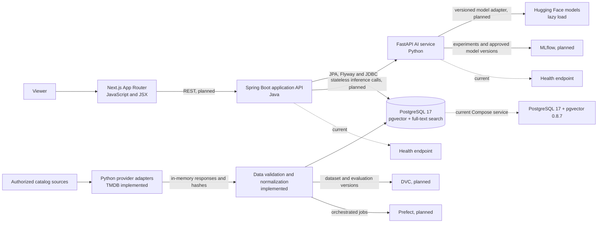
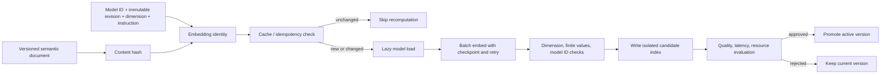
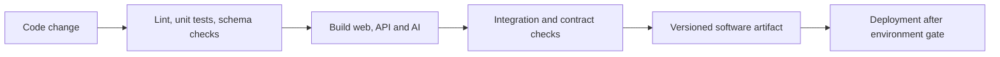
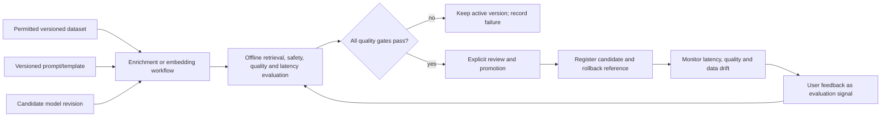

# CineSense architecture

**Status:** Phase 3 ingestion foundation implemented, with live TMDB access gated on explicit operator terms/source acknowledgements. The web discovery, recommendation engine, and AI enrichment remain planned. This document distinguishes running components from planned components.

## Product and engineering principles

- Users describe a feeling or story in natural language and may refine that intent over multiple turns.
- Search intent keeps required conditions, preferences, exclusions, and uncertain interpretations separate. A preference is never silently promoted to a hard filter.
- Unknown facts stay `UNKNOWN`; they are not converted into `NONE`. Imported, AI-inferred, and independently verified values retain distinct provenance and evidence.
- Only retrieved evidence can support a factual explanation. Similarity or a reranker score alone cannot prove a plot event or content attribute.
- Catalog providers, model implementations, and embedding versions are replaceable behind contracts. Large models and datasets are not part of source control or initial startup.
- Source terms travel with the data. An open identifier match does not grant rights to the matched source's overview, poster, or plot.

## System boundaries



### Current implementation

- `apps/web`: Next.js 16 App Router and React in JSX; a foundation landing screen with Tailwind CSS, custom design tokens, and Lucide icons, not a connected discovery flow. Its scripts select the supported Webpack compiler because Turbopack's PostCSS child process exited during a Windows build in this environment. Motion is deferred until an interaction benefits from it.
- `services/api`: Spring Boot 4.2 / Java 21 with `/health`, Actuator database readiness, PostgreSQL JDBC/JPA, and Flyway schema migrations. Auth and feature APIs are not implemented.
- `services/ai`: FastAPI with `/health`; no model loading, inference, or recommendation mocks.
- `docker-compose.yml`: local PostgreSQL 17 with pgvector 0.8.7. Migrations run on API startup. Monitoring, orchestration, and model services are later phases.
- `.github/workflows/ci.yml`: frontend build, API Maven verification, and AI health test checks.

## Component responsibilities

| Component | Owns | Must not own |
|---|---|---|
| Next.js web | Accessible discovery, search refinement UI, movie presentation, watchlist/profile views | Provider credentials, source ingestion, model inference |
| Spring Boot API | Identity and authorization, user state, search sessions/messages, preferences, watchlists, orchestration and REST contracts | Embedding model internals or ingestion jobs |
| FastAPI AI | Query intent parsing, embedding adapters, retrieval/rerank orchestration, enrichment, evidence-grounded explanation | Authentication or durable user profile state |
| Data platform | Provider adapters, raw snapshots where permitted, normalization, provenance, validation/quarantine, semantic documents | User-specific application state |
| PostgreSQL | Canonical catalog, evidence/provenance, app data, search state, full-text index and version-isolated vectors | Model downloads or large source archives |
| MLOps | Reproducible experiments, data/model version references, quality gates, model promotion and rollback | Silent model promotion based on successful inference alone |

## Data ingestion and evidence lifecycle

```mermaid
flowchart LR
  Src[Source API or licensed file] --> Capture[Checkpointed provider adapter]
  Capture --> Raw[Raw snapshot with source ID, retrieval time and terms]
  Raw --> Normalize[Normalize and deduplicate]
  Normalize --> Validate{Schema and rights checks}
  Validate -->|invalid| Quarantine[Quarantine with reasons]
  Validate -->|valid| Canonical[Canonical records + field-level provenance]
  Canonical --> Enrich[Optional AI enrichment<br/>explicitly inferred]
  Enrich --> Review[Evidence and human-review state]
  Canonical --> Documents[Versioned semantic document]
  Review --> Documents
  Documents --> Hash[Content hash and template version]
  Hash --> Embed[Versioned embedding job]
  Embed --> Index[(Candidate vector index)]
  Index --> Eval[Retrieval and regression evaluation]
  Eval -->|pass| Promote[Explicitly promote active index]
  Eval -->|fail| Retain[Keep prior active index]
```



Raw and processed assets are kept outside Git. DVC use and artifact storage will be selected only after source terms allow the proposed storage, access, and retention. Each field and each inferred enrichment needs a source/status, evidence or rationale, confidence where applicable, model/prompt version, and timestamps. Inferred attributes remain visibly inferred; human correction does not erase the original model output.

## Query, retrieval and grounded response

```mermaid
sequenceDiagram
  actor Viewer
  participant UI as Next.js
  participant API as Spring Boot
  participant AI as FastAPI
  participant Store as PostgreSQL / pgvector
  Viewer->>UI: Describe or refine a movie request
  UI->>API: Search turn + session context
  API->>AI: Context and current request
  AI->>AI: Parse required, preferred, excluded, uncertain intent
  AI->>Store: Hybrid candidates: vector + full text + exact metadata
  Store-->>AI: Candidate IDs and source evidence
  AI->>AI: Apply hard constraints; rerank eligible candidates
  AI->>AI: Draft explanations only from retrieved evidence
  AI-->>API: Results, evidence references, uncertainty and updated intent
  API->>Store: Persist session and interpretation (planned)
  API-->>UI: Validated response
  UI-->>Viewer: Ranked matches and honest unknowns
```

The retrieval plan is pgvector cosine similarity plus PostgreSQL full-text and exact metadata matching. Reciprocal Rank Fusion is the first fusion candidate; it must be evaluated against a labeled query set before being treated as an accepted default. Apply exclusions and required constraints using structured evidence, then rerank the eligible set. If a requirement cannot be verified, label the match partial/uncertain or omit it; do not claim the requirement is met. A rephrased user turn updates the stored interpretation instead of discarding the session.

## Embedding lifecycle and rollback



Candidate models, not yet selected: `Qwen/Qwen3-Embedding-0.6B` (reported 1024 dimensions), `Qwen/Qwen3-4B-Instruct-2507`, and `Qwen/Qwen3-Reranker-0.6B`; benchmark alternatives include `BAAI/bge-m3` and `Qwen/Qwen3-Embedding-4B`. Exact immutable model revisions and embedding instructions must be chosen and recorded before downloading or indexing. Model startup is lazy, credentials come from environment/secret stores, and CPU support is required for small checks. No candidate is downloaded or presented as active during Phase 1.

## CI/CD and continuous-learning boundaries





Feedback can inform evaluation or a reviewed annotation queue; it never silently retrains or changes the active model. The GitHub workflow is build/test CI in this foundation, not a production deployment pipeline.

## Phase 1 decisions and open questions

1. Keep the monorepo and the requested three runtime languages. Avoid adding a service for each infrastructure tool.
2. Treat TMDB as the primary candidate catalog API, subject to developer approval, current API terms, request limits, attribution, and a future commercial license if needed.
3. Use MovieLens only as a research/evaluation source after selecting a release and accepting that release's terms; never treat ratings or tags as verified plot facts.
4. Use Wikidata for sourced structured facts and identifier reconciliation, not as a complete catalog or a plot source.
5. Treat CMU plot summaries as optional research/enrichment input because CC BY-SA and the underlying source/metadata chain need explicit review before derived artifacts are published.
6. Do not choose corpus size, retain source text, build embeddings, or publish assets until provider coverage, rights, and permitted storage/derived use have been verified.
7. Phase 2 selected PostgreSQL 17 + pgvector 0.8.7 and Flyway. The schema captures source records, field-level provenance, normalized identity, narrative taxonomy, content assertions, and model-versioned semantic documents/embeddings. No movie dataset or model was added.

## Current workspace map

See the actual paths in [README](README.md), [Phase 1 source research](DATA_SOURCES.md), [data dictionary](DATA_DICTIONARY.md), and [progress record](docs/PROGRESS.md). Model cards, pipeline runbooks, MLOps, deployment, and production operations are deferred until their designs are backed by implementation.
