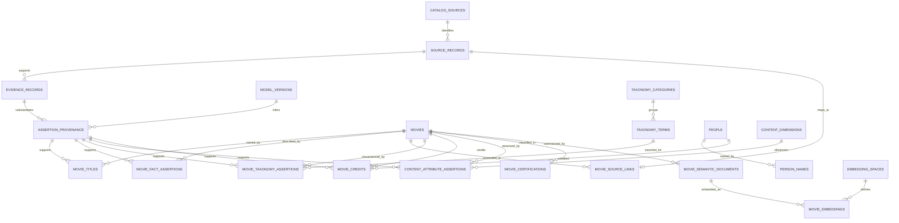

# CineSense database design (Phase 2)

## Design proposal

The schema separates canonical entities from sourced claims. A `movie` or `person` has a stable internal UUID; provider identifiers attach through source records. Every title, fact, credit, taxonomy label, content rating, and certification points to assertion provenance. Provenance records the source evidence, origin, confidence, review state, model revision, prompt version, and supersession chain where applicable. This preserves disagreements and corrections without overwriting source history.

Movie discovery needs conventional metadata and nuanced narrative concepts. A reusable `taxonomy_categories` / `taxonomy_terms` hierarchy provides `genre`, `theme`, `activity`, `relationship_dynamic`, `plot_element`, `narrative_trait`, and `psychological_element` categories. Movie associations are assertions with polarity, relevance, and provenance. This keeps the vocabulary extensible while preserving category-specific reporting; a fixed genre-only enum would be simpler but too narrow for natural-language discovery.

Content attributes describe intensity by dimension and use explicit `UNKNOWN`; regional certifications remain a separate table because a certification is a jurisdiction-specific official label, not a universal measure of violence, nudity, or other content. Semantic text is stored only when its source policy is `PERMITTED`. Reference-only or unknown policy rows retain hashes and evidence references but no generated text. Embeddings are keyed by a declared model revision, dimension, instruction version, and document template version. A foreign key and dimension check prevent mixing vectors from incompatible spaces. An ANN index is deferred until a real embedding model, workload, and latency/recall measurements exist; initial exact search can use PostgreSQL and avoids a premature index per model.

The schema does not copy raw provider payloads or fabricate catalog data. `source_records` retain provider identity, retrieval time, source revision, URI, and optional payload hash. Evidence excerpts are optional and should be stored only where the source terms permit them. Field-level assertions use typed value columns rather than an opaque JSON document, so basic constraints and filters remain queryable. Their tradeoff is that adding a new canonical fact requires a reviewed migration.

## Entity and relationship map

## Migration sequence

| Migration | Responsibility |
|---|---|
| `V1` | Enable pgvector and `pg_trgm`. |
| `V2` | Source registry and records, evidence, model versions, assertion provenance. |
| `V3` | Movie identity, localized titles, provider links, typed factual assertions, production countries. |
| `V4` | Extensible narrative taxonomy, category seeds, movie taxonomy assertions. |
| `V5` | Person identity, localized names, provider links, cast and crew credits. |
| `V6` | Content dimensions/assertions and region-specific certifications. |
| `V7` | Rights-aware semantic documents, evidence links, immutable embedding-space metadata and vectors. |
| `V8` | Full-text, trigram and relationship indexes. |
| `V9` | Canonical localized movie text assertions; ingestion runs, page checkpoints, sanitized failures, quality metrics, semantic-document stale markers. |
| `V10` | Provider genre/company source links and external IDs; provider-claim idempotency and temporal indexes; nullable cast character support. |
| `V11` | Reviewable title/year identity match candidates without automatic movie merges. |
| `V12` | Validity history for provider-sourced movie/production-company relationships. |

Flyway runs these in version order at API startup. Applied migrations are immutable; schema updates use a new migration and Hibernate runs in `validate` mode only.

Phase 3 adds canonical overview/tagline as source assertions rather than using semantic documents as the source of synopsis. `ingestion_runs`, `ingestion_checkpoints`, `ingestion_failures`, and `ingestion_quality_metrics` record bounded job progress and recovery. V10 enables TMDB `GENRE` and `COMPANY` source-record types, maps external identifiers and company data, and supports temporal relationships. V11 stores fuzzy title/year candidates with score and signals for human review; V12 versions production-company membership. Matching never merges records itself.

## Constraints and search indexes

- Provider/entity/external-ID is unique, preventing duplicate imported identity mappings.
- One primary movie title and person name is permitted per locale; alternate/transliterated names remain available.
- Assertions require provenance. Confidence/relevance is bounded between 0 and 1, and review state distinguishes accepted, rejected, disputed, and unreviewed claims.
- Fact assertions use typed columns and valid-time bounds. Content intensity distinguishes `NONE` from `UNKNOWN`.
- Semantic document text must be absent unless policy is explicitly `PERMITTED`.
- Embedding rows reference an embedding space and must match both its declared dimension and actual vector dimension.
- `pg_trgm` GIN indexes support fuzzy/substring lookup for titles and person names. PostgreSQL full-text GIN indexes permitted semantic documents. Foreign-key and reverse-lookup indexes support joins and filters.

Trigram indexes are most selective for terms of three or more characters; a two-character typed-ahead query such as `ja` can scan many rows. The API should impose a minimum query length and evaluate a dedicated 2-gram index only if measured catalog scale warrants its storage and write cost.

## Versioning and provenance rules

The internal UUID does not replace a provider identifier. Source links retain each provider record so records can be reconciled or split later. Evidence is attached to provenance, and each canonical field assertion points to its provenance row. Model inference records a model version and optional prompt version; a human review creates a new assertion or supersession rather than erasing model output. A source correction creates a new claim and closes or supersedes the prior claim according to the ingestion policy.

Vector spaces include provider, model name, immutable model revision, dimension, instruction version, template version, and similarity metric. During a model migration, old and new spaces coexist until evaluation approves a promotion. Embedding generation, model downloads, HNSW indexes, and bulk catalog seeding are deliberately outside Phase 2.
