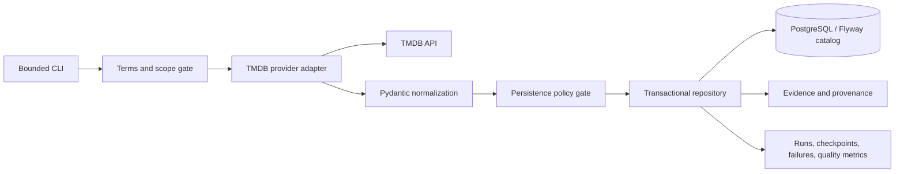
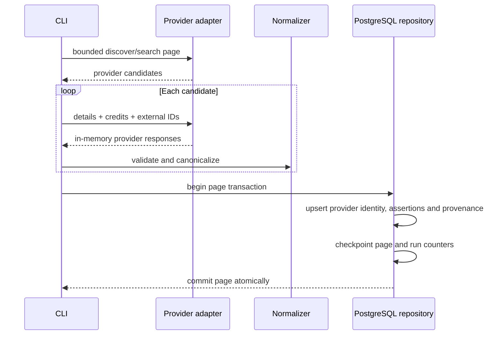
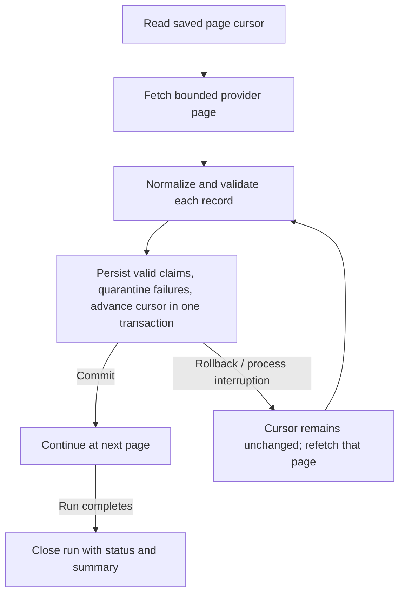

# CineSense data platform

The Python package in `data-platform/` ingests bounded TMDB discovery/search results independently from the FastAPI inference service. It normalizes provider payloads into Pydantic contracts and stores assertions in the existing PostgreSQL schema through the same Flyway migrations as the Spring API. It never stores complete response bodies or raw debug snapshots.

## Windows 11 / PowerShell setup

From the repository root:

```powershell
py -3.14 -m venv data-platform/.venv
data-platform/.venv/Scripts/Activate.ps1
python -m pip install -r data-platform/requirements-test.txt
if (-not (Test-Path .env)) { Copy-Item .env.example .env }
```

The package reads process environment variables; PowerShell does not automatically export `.env` into a process. To load the TMDB and datasource settings without echoing them:

```powershell
Get-Content .env | Where-Object { $_ -match '^(TMDB_API_READ_ACCESS_TOKEN|TMDB_API_KEY|TMDB_USAGE_SCOPE|TMDB_TERMS_ACKNOWLEDGED|TMDB_ATTRIBUTION_ACKNOWLEDGED|TMDB_LOGO_ACKNOWLEDGED|TMDB_POLICY_REVIEWED_ON|TMDB_SOURCE_POLICY|TMDB_PERSISTENCE_ACKNOWLEDGED|TMDB_TIMEOUT_SECONDS|TMDB_MAX_RETRIES|TMDB_MIN_REQUEST_INTERVAL_SECONDS|CINESENSE_DATABASE_URL|SPRING_DATASOURCE_URL|SPRING_DATASOURCE_USERNAME|SPRING_DATASOURCE_PASSWORD)=' } | ForEach-Object { $name, $value = $_ -split '=', 2; Set-Item -Path "Env:$name" -Value $value }
```

Or set values in the current process explicitly (fill only after reviewing current terms and product attribution):

```powershell
$env:TMDB_API_READ_ACCESS_TOKEN = '<TMDB read access token>'
$env:TMDB_USAGE_SCOPE = 'non-commercial'
$env:TMDB_TERMS_ACKNOWLEDGED = 'true'
$env:TMDB_ATTRIBUTION_ACKNOWLEDGED = 'true'
$env:TMDB_LOGO_ACKNOWLEDGED = 'true'
$env:TMDB_POLICY_REVIEWED_ON = (Get-Date -Format 'yyyy-MM-dd')
```

The app currently displays the required TMDB statement in the home footer. TMDB's FAQ also requires its approved logo in an About/Credits location for non-commercial use. Add the official supplied logo and complete that review before setting `TMDB_LOGO_ACKNOWLEDGED=true`; all provider requests remain blocked without it. The exact statement is: **This product uses the TMDB API but is not endorsed or certified by TMDB.** Review [TMDB terms](https://www.themoviedb.org/documentation/api/terms-of-use), [API FAQ and attribution](https://developer.themoviedb.org/docs/faq), [authentication](https://developer.themoviedb.org/docs/authentication-application), and applicable caching, storage, redistribution and commercial-use terms yourself. The policy gate intentionally defaults to unknown/false; successful API access is not permission to persist. This project does not assert a retention period or license that has not been confirmed.

## Commands

The defaults never write to PostgreSQL. If database settings are available, dry-run opens a read-only connection to report likely insert/update/skip actions and scored duplicate candidates; without them, database match assessment is explicitly unavailable. Provider access requires a credential and explicit terms/scope/attribution acknowledgements.

```powershell
python -m data_platform.cli tmdb discover --limit 20 --dry-run
python -m data_platform.cli tmdb search --query 'Arrival' --limit 20 --dry-run
python -m data_platform.cli tmdb genres --dry-run
```

Persistence additionally requires an explicit `--execute`, configured database, `TMDB_SOURCE_POLICY=PERMITTED`, and `TMDB_PERSISTENCE_ACKNOWLEDGED=true` after checking permitted uses. Set `CINESENSE_DATABASE_URL` or use `SPRING_DATASOURCE_URL`, `SPRING_DATASOURCE_USERNAME`, and `SPRING_DATASOURCE_PASSWORD`. Then:

```powershell
$env:TMDB_SOURCE_POLICY = 'PERMITTED'
$env:TMDB_PERSISTENCE_ACKNOWLEDGED = 'true'
python -m data_platform.cli tmdb discover --limit 20 --execute
```

The limit is constrained to 1–250. Checkpoints are keyed by operation, query and language; a later run resumes from the last transactionally committed page. An API page is read before its movie claims and checkpoint are committed together. Failed detail/normalization records are quarantined with a sanitized summary. No full-catalog import runs automatically. `retry-failures --execute` retries bounded open/retryable movie IDs, updates attempts and resolves failures after persistence. Its dry-run states that no database query was made.

## Provider and ingestion architecture







## Provenance and data quality

Movie/provider stable IDs anchor source-record identity. Each field/claim creates an evidence row with a field locator and payload SHA-256, then a `PROVIDER` provenance row. Canonical title, date/runtime/language/status/adult/budget/revenue, overview/tagline, genre, country, company, external identifier, person-name and credit claims point to this provenance. The raw response is handled in memory; plot text is stored only in the dedicated canonical text assertion and only after policy acknowledgement. Person IDs are reused across movie credits. TMDB genre IDs map to the existing `genre` category as `tmdb-<id>`.

Repeated identical revisions reuse evidence and provenance and are protected by database uniqueness constraints. Changed text/facts keep superseded assertions with validity timestamps; current credits, countries, and genre mappings are expired on changed provider snapshots. Semantic document rows are marked stale when canonical input changes; embeddings and AI enrichment are not generated. Similar title/year records receive a scored `REVIEW_REQUIRED` candidate and are never merged automatically.

Run summaries are stored in `ingestion_runs`; committed pages update `ingestion_checkpoints`; invalid and failed movie records are stored in `ingestion_failures`. Rejected/failure detail is constrained and never includes a provider response body. Per-run quality metrics include discovered, accepted, rejected, failed, invalid dates, missing fields, duplicate identities, missing credits and source-mapping failure counts.

## Migrations and tests

- V9 adds canonical movie text assertions, run/checkpoint/failure/quality tables, and semantic-document stale markers.
- V10 adds provider entity identity support, idempotency indexes, temporal relationship assertions, genre source links, external IDs, and production-company tables.
- V11 records reviewable fuzzy title/year identity candidates; matching never merges canonical movies automatically.
- V12 adds validity ranges to movie/company membership so later provider corrections can expire stale relationships.
- Existing V1–V8 are unchanged.

Run mocked tests and PostgreSQL Testcontainers integration tests:

```powershell
python -m pytest data-platform/tests -v
```

The Python integration tests use the existing `pgvector/pgvector:0.8.7-pg17-bookworm` test image and apply the Flyway SQL files in order. They need Docker. Live TMDB ingestion is not part of automated tests.
