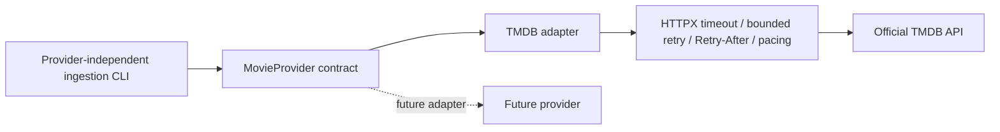
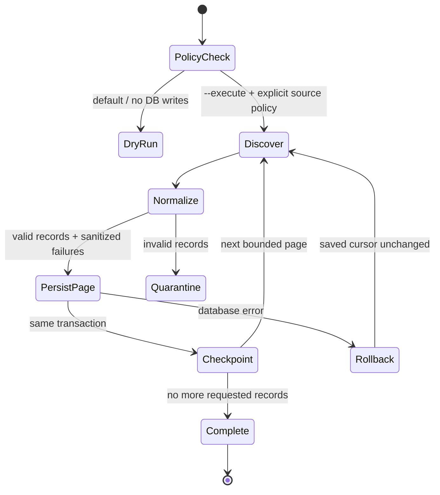
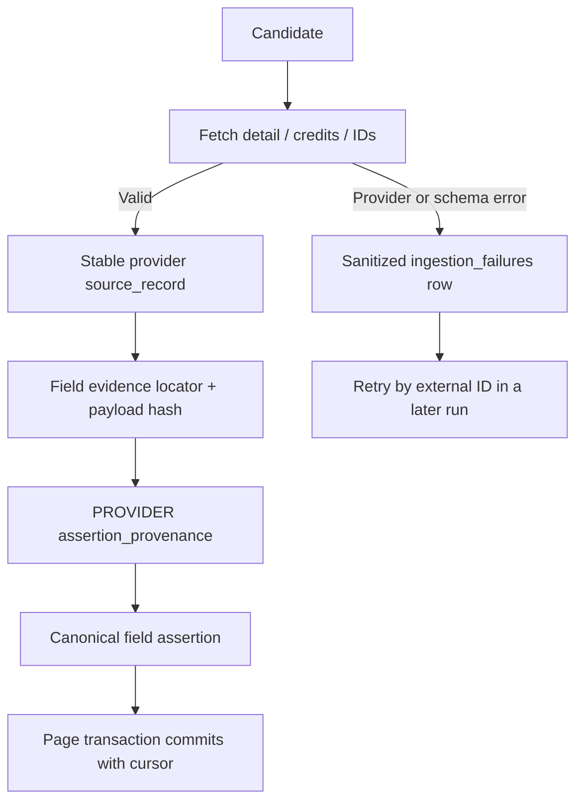

# Data ingestion diagrams

These diagrams describe the Phase 3 data platform. They deliberately stop at canonical source assertions; semantic document generation and recommendation retrieval are later phases.

## Provider adapter boundary

## Ingestion lifecycle

## Failure recovery and provenance

The retry table and schema support individual-ID recovery, but the Phase 3 CLI's `retry-failures` execution is intentionally not enabled until its bounded retry workflow is complete.
